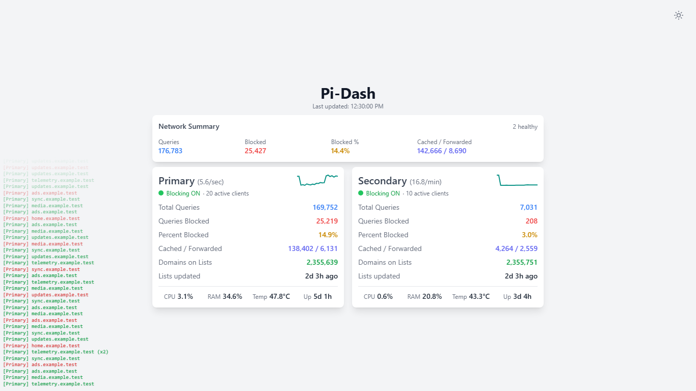
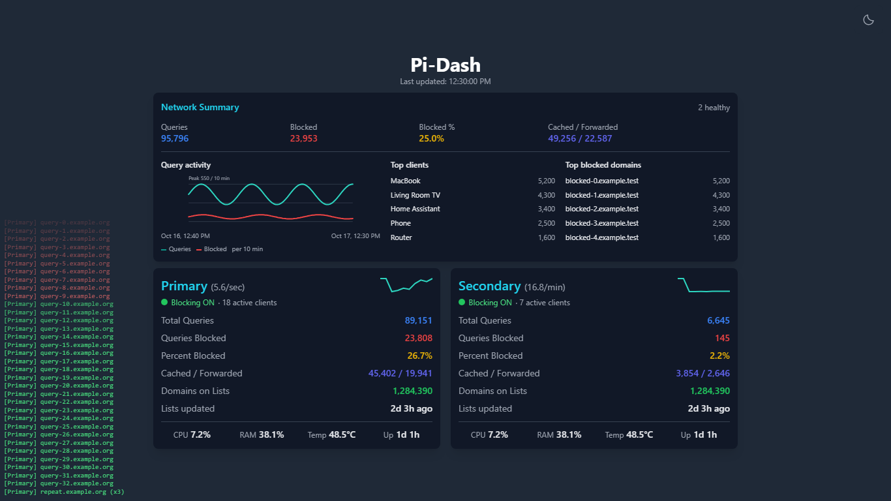
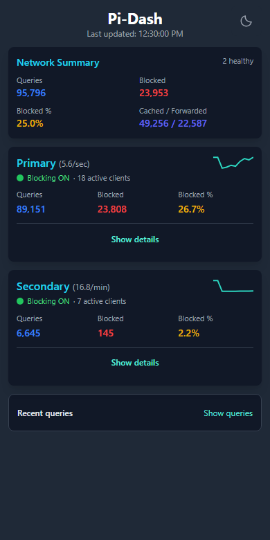
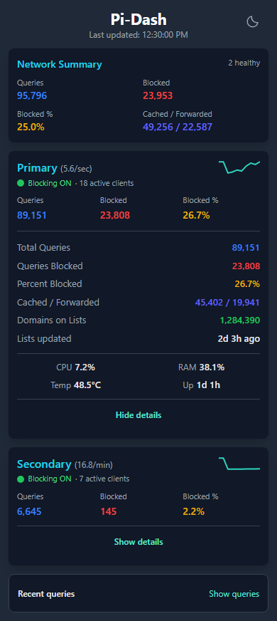

[](https://github.com/surajverma/pi-dash/actions/workflows/main.yml)
[](https://github.com/surajverma/pi-dash/actions/workflows/test.yml)

[](https://github.com/surajverma/pi-dash/commits/main)
[](https://github.com/surajverma/pi-dash/issues)
[](https://github.com/surajverma/pi-dash/stargazers)
[](https://github.com/surajverma/pi-dash/pkgs/container/pi-dash)

# Pi-Dash: A Minimalist Pi-hole Dashboard

Pi-Dash is a simple, lightweight dashboard for monitoring multiple Pi-hole instances. It provides a clean, at-a-glance, responsive view of your Pi-hole statistics.

## Features

- **Multiple Pi-hole Support:** Monitor all your Pi-hole instances from a single dashboard.
- **Network Summary:** View combined query, blocked, cached, and forwarded totals across reporting Pi-holes.
- **Network Insights:** Opt in to query history, top combined clients, and top blocked domains in three desktop columns. Mobile loads these when you expand Network Insights.
- **Device Health:** CPU, RAM, temperature, system uptime, and blocklist update age, grouped separately from the DNS counters. Mobile keeps these inside Show details.
- **Pi-hole Status:** See reachability, authentication errors, and blocking ON/OFF state for each instance.
- **Responsive Design:** Desktop shows the full dashboard and ambient query feed. Mobile shows critical metrics in compact cards, with an accessible control to expand all available metrics.
- **Live Query Feed:** Optionally show recent allowed and blocked domains. Consecutive duplicate queries are grouped with `(x2)`, `(x3)`, and similar counts.
- **Configurable Refresh:** Set separate refresh intervals for statistics and queries. If the query interval is omitted, it uses the statistics interval.
- **Efficient Polling:** Polling stops while the page is hidden or the browser is offline, then resumes safely when it becomes active again. A short shared cache reduces duplicate Pi-hole API requests.
- **Lightweight and Fast:** Built with Flask and vanilla JavaScript, with no database or frontend framework.
- **Dark Mode and PWA Support:** Works with your preferred color scheme and can be installed as a Progressive Web App.

## Screenshots

All screenshots use fictional sample data and the current dashboard. The optional query feed is enabled for illustration; no real Pi-hole addresses, credentials, or query history are included.

### Desktop: default view (light mode)

Network insights are off; device metrics are on. The dashboard keeps its compact 768px maximum width. Captured at 1366×768.



### Desktop: optional network insights (dark mode)

Set `"show_network_insights": true` to add the history graph, top clients, and top blocked domains. Only this view expands the desktop dashboard to a maximum width of 896px.



### Mobile: compact and expanded views (dark mode)

Mobile starts compact. Tap **Show details** to reveal instance counters and hardware readings.

| Compact default | First instance expanded |
| --- | --- |
|  |  |

## Configuration

Copy `config-example.json` to `config.json` and edit it for your network. The example is valid JSON without comments; all options and their defaults are described below.

Configuration is read at startup, so restart the container or process after changing `config.json`. Pi-Dash loads the path in `PI_DASH_CONFIG` when set, otherwise `config.json` in the repository root (`/app/config.json` in Docker); a missing file stops startup with a clear error.

The dashboard has no login of its own and shows live DNS queries when `show_queries` is enabled, so keep it on the LAN or behind a reverse proxy with authentication.

### 1. `config.json`

```json
{
  "base_path": "/",
  "refresh_interval": 2000,
  "queries_refresh_interval": 3000,
  "cache_ttl": 1000,
  "show_queries": false,
  "show_network_summary": true,
  "show_trends": true,
  "show_network_insights": false,
  "show_device_metrics": true,
  "piholes": [
    {
      "name": "Primary",
      "address": "https://pi.hole",
      "password": "${PIHOLE_PRIMARY_PASSWORD}",
      "enabled": true,
      "link": true,
      "verify_ssl": false
    }
  ]
}
```

The example includes the two new flags:

- `show_network_insights: false` keeps the graph and both rankings hidden and skips their API requests. Change it to `true` to enable them.
- `show_device_metrics: true` enables CPU, RAM, temperature, and uptime in each instance's details. Set it to `false` to hide them and stop their API requests.

These defaults also apply when the flags are omitted from older configurations. See the [upgrade notes](CHANGELOG.md#unreleased) for the polling change. The existing `show_network_summary` flag still defaults to `true` and controls the original summary counters.

#### Dashboard options

| Option | Default | Description |
| --- | --- | --- |
| `base_path` | `/` | Subpath where Pi-Dash is hosted, for example `/pi-dash/`. |
| `refresh_interval` | `5000` | Statistics refresh interval in milliseconds. |
| `queries_refresh_interval` | `refresh_interval` | Query-feed refresh interval in milliseconds. |
| `cache_ttl` | Automatic | Shared backend cache lifetime in milliseconds. Set to `0` to disable caching. |
| `show_queries` | `false` | Show the live DNS query feed. Allowed queries are green and blocked queries are red. |
| `show_network_summary` | `true` | Show combined statistics from all reporting Pi-holes. |
| `show_trends` | `true` | Show short, in-memory query-rate sparklines. |
| `show_network_insights` | `false` | Show combined history and top-five rankings inside Network Summary. Requires `show_network_summary`. |
| `show_device_metrics` | `true` | Show optional hardware readings in instance details. |
| `piholes` | `[]` | List of Pi-hole instances to monitor. |

When `cache_ttl` is omitted, Pi-Dash calculates it as half of the shortest refresh interval, with a minimum of 100 ms and a maximum of 1000 ms. The values in `config-example.json` are recommended example settings; omitted options use the defaults above.

#### Pi-hole options

| Option | Default | Description |
| --- | --- | --- |
| `name` | Required | Display name for the Pi-hole. Names must be unique. |
| `address` | Required | Full Pi-hole base URL, including the scheme and optional port. Do not include `/admin` or `/api`. |
| `password` | Empty string | Pi-hole API/application password. Literal values and `${ENV_NAME}` references are supported. |
| `enabled` | `true` | Set to `false` to hide and stop monitoring an instance without deleting it from the configuration. |
| `link` | `false` | Make the Pi-hole name a link to its admin interface. |
| `verify_ssl` | `false` | Set to `true` to verify trusted HTTPS certificates, or provide a CA bundle path. |

Settings omitted from `config.json` use the defaults above, so existing configurations continue to work. Existing installations may also continue storing the password directly in `config.json`:

```json
"password": "your_app_password_here"
```

For new installations, the password can instead be kept outside `config.json` by referencing an environment variable:

```json
"password": "${PIHOLE_PRIMARY_PASSWORD}"
```

With Docker Compose, add the corresponding value to a `.env` file beside `compose.yaml`:

```dotenv
PIHOLE_PRIMARY_PASSWORD=your_app_password_here
```

The Compose example below passes this variable to Pi-Dash. For Docker Run, use `--env-file .env`; for a native installation, export the variable in your shell before starting Pi-Dash. The same `${ENV_NAME}` syntax can be used for a CA bundle path. The `.env` file is ignored by this repository and should not be committed to GitHub.

The Network Summary includes only additive DNS counters: total queries, blocked queries, cached queries, and forwarded queries. It does not combine active clients, unique domains, or domains on lists because those values can overlap between Pi-holes. If an instance is unavailable, the summary is marked as partial.

Desktop keeps all instance details open, with DNS activity and device health grouped separately. Mobile retains the three important counters and Show details. The desktop query feed stays in the background; mobile retains its separate Recent queries control.

Network Insights uses Pi-hole's rolling in-memory reporting window (normally about 24 hours; retention and privacy settings can affect it). History is aligned into ten-minute buckets, with at most the latest 24 hours drawn. Missing buckets are not filled with invented zeros. Rankings combine matching client addresses or normalized domains before selecting the top five. Client names are labels, so unrelated devices with the same name are not merged. Tap/click a ranking row to reveal its full name and address. Counts are observed DNS requests, not deduplicated user activity; chained Pi-holes can observe the same request more than once.

Up to 100 source entries per ranking and Pi-hole are combined. Pi-Dash uses each truncated list's smallest count to bound omitted candidates. It shows "Approximate ranking · counts near the cut-off" only when those bounds cannot confirm the combined top five. A single reporting Pi-hole never triggers this warning. A `≥` before a count means that item was omitted from another truncated source and its combined count may be higher. "Partial data" means some Pi-holes did not report or hid their data. Pi-hole's own excluded-client/domain and privacy settings remain respected. Shares use the corresponding total queries or blocked queries, so the five visible rows need not add up to 100%. Missing instances and unavailable sections are labelled independently.

Device metrics and network insights load independently of the fast DNS counters, normally refresh every 30 seconds per browser, and share a separate 30-second server cache. Waiting tabs retry a refresh-in-progress response after two seconds. Mobile requests optional data only while the relevant section is expanded. All polling pauses while the page is hidden or offline. An unavailable sensor or unsupported API does not mark a working DNS server offline; its reading displays Unavailable. Healthy status dots pulse gently only while the latest DNS snapshot is fresh, and respect reduced-motion preferences.

CPU is Pi-hole's reported total CPU use divided by the number of processors, displayed on a device-wide 0–100% scale. RAM and system uptime are the system readings, not the FTL process figures. Container installations report the system visible to Pi-hole and may not expose temperature sensors. Lists updated uses Pi-hole's gravity timestamp. Cached / Forwarded remains the raw pair of counters (Pi-hole's cached count can include locally configured answers).

The dashboard follows the system color scheme by default and updates when it changes. Use the corner theme icon to cycle through System, Light, and Dark. Existing saved Light/Dark preferences remain respected; select System to return to automatic switching.

When the query feed is enabled, it displays recent queries while the dashboard is visible and online. Only consecutive entries with the same Pi-hole, domain, and blocked/allowed state are grouped. The feed is intended as a live overview; use Pi-hole's query log for complete history.

### 2. `manifest.json` (Optional)

This optional file customizes the Progressive Web App name and colors. Pi-Dash bundles its own V2 transparent PNG icons, served from the dashboard's origin:

Manifest lookup uses `PI_DASH_MANIFEST` when set, then a root-level `manifest.json` (`/app/manifest.json` in Docker), then the built-in `web/manifest.json`. Existing config and manifest volume mounts keep working. To customize the bundled manifest, copy `web/manifest.json` to the repository root and edit it; omit the optional manifest mount if you use the built-in default. An explicitly configured environment path must exist.

```json
{
  "name": "Pi-Dash",
  "short_name": "Pi-Dash",
  "description": "A simple dashboard to monitor Pi-hole status.",
  "start_url": "/",
  "display": "standalone",
  "background_color": "#111827",
  "theme_color": "#1f2937",
  "icons": [
    {
      "src": "icons/icon-192.png",
      "sizes": "192x192",
      "type": "image/png",
      "purpose": "any"
    },
    {
      "src": "icons/icon-512.png",
      "sizes": "512x512",
      "type": "image/png",
      "purpose": "any"
    },
    {
      "src": "icons/icon-maskable-512.png",
      "sizes": "512x512",
      "type": "image/png",
      "purpose": "maskable"
    }
  ]
}
```

No Pi-hole hostname or port is needed for these icons. Manifest start URL, scope, and app identity follow `base_path`, including subpath installations. Apple touch and 16/32-pixel favicon assets are also bundled. The normal app icons are transparent and declare `purpose: any`; a separate opaque icon declares `purpose: maskable` for Android.

PWA installation requires HTTPS (or localhost), and browser/platform installation behavior varies. If you mount a custom `manifest.json` from an older installation, update its icons to the local entries above or remove the mount to use the bundled manifest. A mounted old manifest continues to override the packaged defaults. The service worker refreshes the app shell and never caches the DNS, ranking, or hardware API responses.

---

## Installation

### Docker Compose

```yaml
services:
  pi-dash:
    image: ghcr.io/surajverma/pi-dash:latest
    container_name: pi-dash
    ports:
      - 5001:5001
    environment:
      PIHOLE_PRIMARY_PASSWORD: "${PIHOLE_PRIMARY_PASSWORD}"
    volumes:
      - ./config.json:/app/config.json:ro
      - ./manifest.json:/app/manifest.json:ro
    restart: unless-stopped
```

### Docker Run

```bash
docker run -d \
  --name pi-dash \
  -p 5001:5001 \
  --env-file .env \
  -v /path/to/pi-dash/config.json:/app/config.json:ro \
  -v /path/to/pi-dash/manifest.json:/app/manifest.json:ro \
  ghcr.io/surajverma/pi-dash:latest
```

### Native Install

1. Clone the repository:

   ```bash
   git clone https://github.com/surajverma/pi-dash.git
   cd pi-dash
   ```

2. Create your configuration and install the dependencies:

   ```bash
   cp config-example.json config.json
   python -m pip install -r requirements.txt
   ```

   On Windows, use `copy config-example.json config.json` instead.

3. Start Pi-Dash:

   ```bash
   python -m pi_dash
   ```

Open `http://localhost:5001` in your browser.

## Health Check

`GET /health` reports whether the Pi-Dash application is running. It does not contact the configured Pi-hole instances.

## Development

### Project layout

```text
pi_dash/       Flask routes (app.py), startup settings (config.py), Pi-hole
               client (pihole.py), shared caches (cache.py), aggregation (aggregate.py)
web/           HTML, service worker, built-in manifest, CSS, JavaScript and icons
tests/         Backend, frontend and rendered-browser regressions
scripts/       Screenshot capture and icon export helpers
src/           Tailwind input; generated CSS goes to web/css/style.css
```

Public asset and API URLs are unchanged except for the renamed `/js/network-insights.js`. The production entrypoint is `pi_dash.app:app`. Keep Gunicorn at **one worker and four threads**: sessions, locks and caches are shared in-process, so extra workers would split caches and multiply Pi-hole logins and API seats.

The automated tests use mocked Pi-hole responses and do not require a live Pi-hole:

```bash
python -m unittest discover -s tests -v
npm ci
npm run test:js
npm run build:css
npx playwright install chromium
npm run test:browser
```

To refresh the README screenshots using production markup and fictional data:

```bash
npm run capture:screenshots
```

This uses the same Playwright Chromium installation as the rendered tests and writes the four images to `docs/screenshots/`.

## Credits

Initial development of Pi-Dash was done by [Codeloaf](https://github.com/codeloaf). It has since been transferred to this repository for ongoing maintenance, as the original author is not active on GitHub.

## Disclaimer

This project is not associated with the official [Pi-hole](https://pi-hole.net/) project. Pi-hole is a registered trademark of Pi-hole LLC.

## License

This project is licensed under the MIT License. See the [LICENSE](LICENSE) file for details.

## Contributing

Contributions are welcome! If you have any ideas, suggestions, or bug reports, please open an issue or submit a pull request.

## Thank You

If you like my work, you can [buy me a coffee ☕](https://ko-fi.com/skv)

The compact desktop view uses header client counts, text-only rankings, and a single hardware strip without section captions. Lists updated remains below Domains on Lists. The normal two-instance layout is checked for no scrolling at 1366×768 and reduced content heights of 680 and 640 pixels. Longer names, extra instances, expanded ranking names, or larger accessibility text may require scrolling.

Network insights are off when `show_network_insights` is omitted, including existing configurations. Device metrics remain on when `show_device_metrics` is omitted. Set either flag explicitly to change that behavior. `show_network_summary` still defaults to true and controls the original four summary counters; disabling it also disables insights and their API requests. Unique Domains is no longer displayed; Domains on Lists is retained.

The V2 vector master is `web/icons/icon.svg`; `web/icons/favicon.svg` uses wider, square bars for small sizes. The SVG sources have no embedded raster artwork or blur filters; PNG and ICO exports retain transparent backgrounds. To regenerate them, run `npm ci`, `npx playwright install chromium`, and `npm run build:icons`. The 16px export uses pixel-aligned bars for legibility.

Optional refreshes use a nonblocking refresh lock: waiting tabs receive the previous snapshot or a loading response and retry after two seconds, rather than occupying web threads. Failed or malformed optional readings are cached for 30 seconds. A detected DNS recovery expires the old readings. The existing four Gunicorn threads are retained.

The 512px maskable icon uses an opaque dark background and keeps the mark inside the central safe circle; the regular PNG icons remain transparent. The manifest theme color matches the dark page background, and the page theme-color metadata follows the selected light/dark mode.
